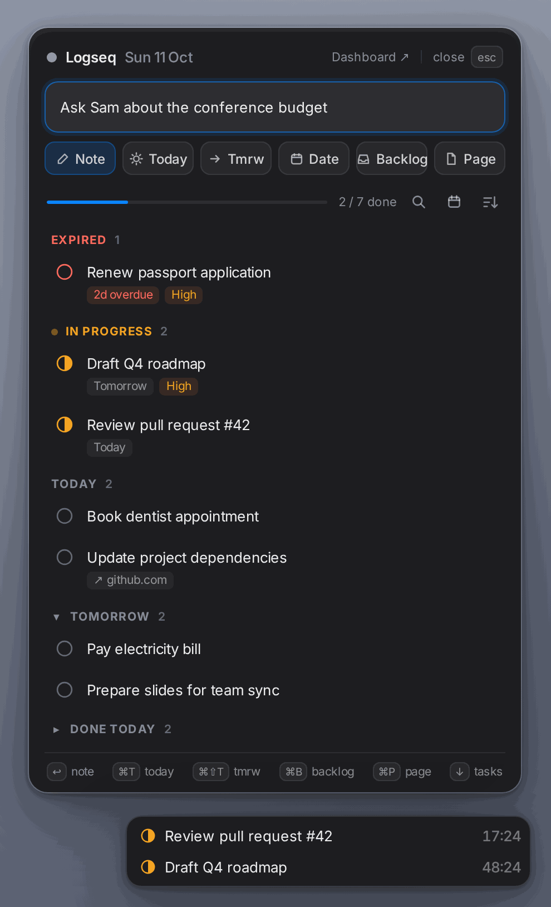

# logseq-hammerspoon

Quick capture and today's tasks for [Logseq](https://logseq.com/) (DB version) on
macOS. Move the mouse to the bottom-right corner, type, press a shortcut. Built on
[Hammerspoon](https://www.hammerspoon.org/).



- **Capture**: journal note, task for today, tomorrow, or a date, backlog task, page.
- **Tasks**: Expired · In progress · Today · Tomorrow · Done today, plus a two-week
  calendar. Keyboard-driven.
- **Peek**: pill in the corner with your Doing tasks and timers.

## Quick start

Needs Hammerspoon, Logseq (DB version), and the Logseq CLI.

> [!IMPORTANT]
> macOS opens **Quick Note** from the bottom-right corner by default, which conflicts
> with the panel. Turn it off: **System Settings → Desktop & Dock → Hot Corners…**,
> set the bottom-right corner to **–**.

Install or update:

```sh
curl -fsSL https://raw.githubusercontent.com/offcall/logseq-hammerspoon/main/install.sh | bash
```

The installer asks for the graph and the dashboard page, then restarts Hammerspoon.
Your Hammerspoon config is kept: `init.lua` only gets `require("logseq_capture")`.

## Configuration

`~/.hammerspoon/logseq_capture_config.lua` (updates never overwrite it):

```lua
return {
    logseq = "/Users/you/.local/bin/logseq",  -- Logseq CLI
    graph = "My graph",
    dashboardPage = "Dashboard",              -- any page; false hides the button
    openHotkey = { {"cmd", "alt"}, "L" },     -- optional
}
```

Reload Hammerspoon after editing.

### Which tasks the panel shows

Open the settings screen with the gear in the panel header (or `⌘,`):

- **Statuses**: pick the open statuses of your graph and whether a `#Task`
  without a status counts as Todo. Doing tasks show without a date; others
  need a deadline or scheduled date.
- **Custom query**: your own datalog query. Keep the pull pattern and
  `:in $ ?until` of the default query; switching to this mode fills it in.

**Test** (`⌘↩`) runs the query and shows the task count and the first titles;
**Save** (`⌘S`) is enabled after a passing test. The choice is stored per graph
in Hammerspoon settings, not in the config file.

## Shortcuts

| Where | Keys |
| --- | --- |
| Capture | `↩` note · `⇧↩` newline · `⌘T` today · `⌘⇧T` tomorrow · `⌘D` date · `⌘B` backlog · `⌘P` page · `↓` list |
| List | `↑↓` / `j k` move · `Space` done · `s` start/pause · `t` tomorrow · `d` reschedule · `b` backlog · `↩` open |
| Anywhere | `⌘Z` undo · `⌘R` refresh · `⌘F` search · `c` calendar · `/` input · `Esc` close |

## How it works

Talks to Logseq only through the official CLI, never edits graph files. Logs go to
the Hammerspoon console with the `[Logseq Panel]` prefix. Design decisions:
[`docs/adr/`](docs/adr/).

## License

[MIT](LICENSE)
